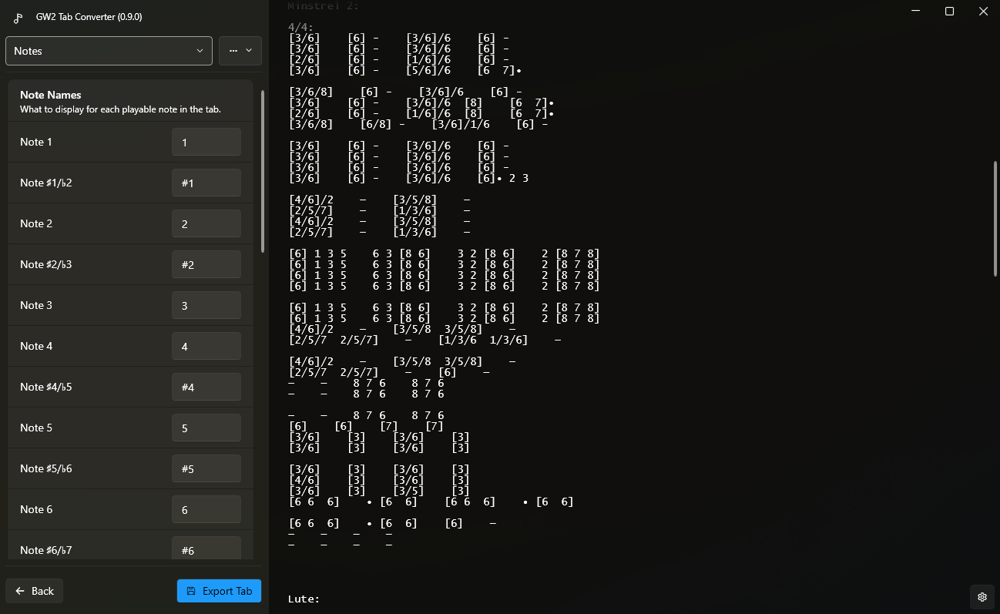

# GW2 Tab Converter
> A Guild Wars 2 tab converter with a focus on customisation.

**GW2 Tab Converter** is a Windows application that converts MIDI (`.mid` and `.midi`) files into human-readable tablature for music in the game _Guild Wars 2_.

**GW2 Tab Converter** is built with styling in mind. You have control over pretty much every aspect of your tablature, from note notation, rest symbols and line breaks to the spacing between beats: **GW2 Tab Converter** lets you quickly create tabs the way _you_ like it. (See [Features](#features) for more!)

## Table of Contents
- [Download](#download)
- [Features](#features)
  - [Planned Features](#planned-features)
- [How to use](#how-to-use)
- [Licensing](#licensing)

## Download
You can download the latest on the [Releases page](https://github.com/Pocram93/GW2-Midi-Converter/releases/latest).

## Features
- :sparkles: High level of customisation
- :memo: Export and load tab styles for an even faster workflow
- :musical_keyboard: Automatic detection of _Guild Wars 2_ instruments 
- :trumpet: You can add your own instruments (in case _Guild Wars 2_ adds more and I am not around to update this app)

### Planned Features

> [!IMPORTANT]
> These features are planned and _not guaranteed_ to be implemented.

- Exporting to CSV for use in spreadsheet notation
- Instrument editor

## Installation

> [!NOTE]
> This application does not yet come with its own installer, so you can put it wherever you want.

1. [Download](#download) the latest version from the Releases page.

> [!NOTE]
> If you cannot see the **GW2.Tab.Converter.zip** file click on **Assets** to expand the list of files.

2. Extract the **.zip** file in a location of your choosing.

## How to use
> This section will be written in the future.

## Troubleshooting
> This section will be written in the future. 

## Licensing
This project is licensed under the [MIT license](LICENSE).